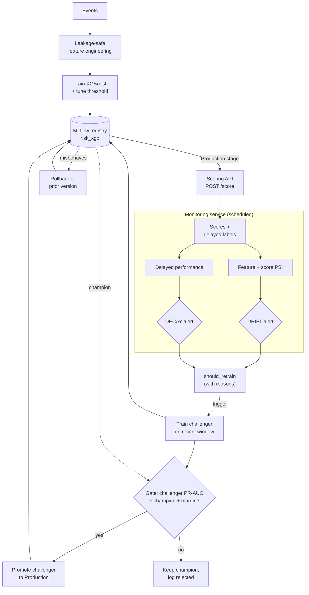
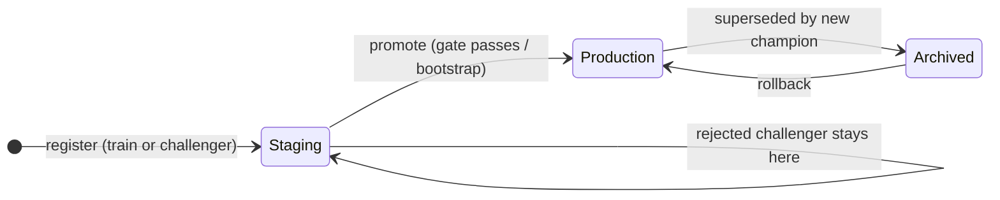
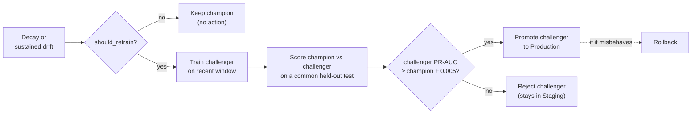

# Methodology

Deep-dive companion to the [README](README.md). The README carries the results
and the commands that reproduce them; this file explains how the pieces work:
feature engineering, the streaming feature store, serving, monitoring, and the
model-lifecycle loop. Everything runs locally, with an MLflow **file store**
under `./mlruns`, JSON-Lines history under `reports/monitoring/`, and no server
or cloud dependency.

Throughout, an **event** is one action that needs a risk decision before it is
accepted, such as a payment, a login or an order. Each event belongs to an
**account**, involves a **counterparty** (the other side of the action, grouped
into anonymized categories `cat_0` to `cat_9`), and arrives from a **device**.
The label `Class = 1` marks a **high-risk event**, which the rest of this
document also calls a positive.

---

## What the label is made of, and why it caps every score

Read this before reading any metric in this repository.

`data/generate_synthetic_data.py` builds labels in two passes. It plants
`n_rows × positive_rate` positives whose PCA components are shifted by 2.5 to
5.0σ on 7 of the 28 components, then flips additional **normal** rows to
positive, weighted by counterparty-category risk and device novelty. The second
pass has a clear purpose. Without it, `counterparty_risk_score`,
`category_risk_score` and `is_new_device` would correlate with nothing, and the
engineered features this project is built around would be pure noise.

The second pass also produces far more positives than the first, and in PCA
space those positives look the same as normal traffic:

| Population | Count | Share of positives |
|---|---:|---:|
| Planted, shifted on 7 PCA components | 850 | 7.2% |
| Flipped, correlates with counterparty/device only | 10,906 | 92.8% |
| **Total positives in 500,000 rows** | **11,756** | **2.35%** |

So `--positive_rate 0.0017` is a *seed* parameter; the realized base rate is
2.35%.

Scoring the trained XGBoost against each population separately separates the
pipeline's ability from the label's learnability. The model and the negatives
stay fixed and only the positives change:

| Positives scored | PR-AUC |
|---|---:|
| Planted positives only (132 in the test split) | **0.691** |
| Flipped positives only (1,634 in the test split) | 0.048 |
| All positives (1,762), the headline number | 0.112 |

The pipeline reaches 0.691 on positives that have structure to find. The
headline 0.112 mixes that with a subpopulation that has nothing learnable in it.
Reproduce with `python scripts/signal_decomposition.py`
(`reports/signal_decomposition.json`).

Two consequences carry into any reading of this repo:

- **Low absolute scores here are a property of the data.** Do not tune against
  the headline number; the label bounds it from above.
- **SHAP output is partly circular on this data.** `counterparty_risk_score`
  dominates global importance because 93% of the positives were relabelled on
  counterparty category in the first place. The attribution mechanism is sound
  and is the deliverable, but its *ranking* on this dataset mostly recovers the
  generator rather than validating the feature design.

---

## Feature engineering

All features are computed **causally**, using only information available
strictly before each event's timestamp (`src/feature_engineering.py`).

| Feature | Description |
|---|---|
| `seconds_since_last_event` | Time since this account's previous event. The first-ever event gets a large sentinel value instead of 0. |
| `velocity_count_{10,60,1440}m` | Count of this account's events in the trailing 10 min / 1 h / 24 h window, excluding the current event. |
| `velocity_amount_{10,60,1440}m` | Sum of `Amount` in the same trailing windows. |
| `counterparty_risk_score` | Smoothed target-encoded historical positive rate per counterparty, fit on the training split only. |
| `category_risk_score` | The same encoding at the counterparty-category level. |
| `is_new_device` | Whether this device has not been seen for this account before this point in time. |
| `distinct_device_count_so_far` | Running count of distinct devices this account has used. |

Velocity, recency, counterparty-risk and device-consistency features are
implemented. Geo-mismatch and graph-based account-counterparty linkage features
are not yet implemented; see "Limitations" in the README.

## Imbalance handling

Configurable via `--imbalance_strategy`:

- `class_weight` (default): `scale_pos_weight` for XGBoost and `class_weight="balanced"` for the sklearn models. The loss is reweighted and the data is left untouched.
- `smote`: oversamples the minority class with SMOTE **after** the time-based split. Fitting SMOTE before the split would leak synthetic points derived from val/test positives into training.
- `none`: no correction, useful as a baseline to see how much the other two help.

The decision threshold is tuned on the **validation set only**
(`src/imbalance.py::tune_threshold_for_f1`). It reports the F1-optimal
threshold and a precision-constrained alternative, which is useful when the
review team has to cap its false-positive load at a minimum precision.

## Explainability

`src/explainability.py` uses SHAP's `TreeExplainer` for two purposes:

- **Global**: `reports/shap_summary.png` and `reports/shap_top_features.csv` show which features drive the model overall, for model governance and validation review.
- **Local**: `explain_single_event()` returns the top contributing factors for one event. The `/score` API includes them in its response when `explain: true` is passed, which is what an alert-triage UI would show a reviewer.

---

## Real-time feature store

The velocity, recency and device features are cheap to compute in batch over a
whole DataFrame, but recomputing them per request at 1M+ events/day is not
possible. `src/online_features.py` is the online counterpart: a **stateful
streaming aggregator** that keeps per-account state up to date incrementally
and serves the same features the batch pipeline produces.

**Two-phase, causal contract.** Every event is handled in two steps:

```python
feats = store.get_features(event)   # state AS OF NOW, excluding this event
# ...score the model...
store.commit(event)                 # fold this event in, for FUTURE events
```

`get_features` never sees the current event in its own state. Velocity excludes
the current row and `is_new_device` is evaluated against prior devices only,
which mirrors the batch semantics (the batch pipeline gets the same guarantee
from sort + shift). `commit` is what makes an event count for the *next* one.
Scoring always happens before the commit, and that ordering is the causality
guarantee.

**Redis data structures** (per `account_id`):

| Key | Type | Purpose |
|---|---|---|
| `fs:vel:{acct}` | **sorted set**, score = event epoch seconds | Sliding-window velocity. `ZRANGEBYSCORE (now-w, now]` returns a window's events in `O(log N + K)`; `ZREMRANGEBYSCORE` ages out anything older than the largest window. The member is `"{epoch}\|{amount}\|{event_id}"`, so amounts can be summed per window and members stay unique. |
| `fs:last:{acct}` | string | Last event epoch, the source of `seconds_since_last_event` (large sentinel, never 0, on the first-ever event). |
| `fs:dev:{acct}` | set | Distinct device ids, the source of `is_new_device` and `distinct_device_count_so_far`. |

A time-scored sorted set behaves as a sliding window: old events age out with
one range delete, and any window (10m/60m/1440m) is a single range query. TTLs
keep memory bounded for dormant accounts. Commits run inside a `MULTI` pipeline
so concurrent workers cannot interleave a partial update. Counterparty risk is a
static offline lookup (from `counterparty_risk_map.joblib`) instead of streaming
state, so it stays a plain dict lookup.

**In-memory fallback.** `InMemoryFeatureStore` implements the same interface
with a per-account lock, so the repo runs and the test suite passes with **no
Redis server**. Select the backend with `FEATURE_STORE_BACKEND=redis|memory`
and `REDIS_URL`.

**Train/serve parity.** `tests/test_streaming_parity.py` runs a fixed event
stream through *both* the batch pipeline and the streaming store and asserts
that the feature rows are identical, for both backends. This test is the proof
that the serving path has not drifted from what the model was trained on. Batch
and streaming read the window widths and the first-event sentinel from a single
definition in `src/feature_engineering.py`.

## Deployment / serving

`src/api.py` is a FastAPI service exposing `POST /score`, with two ways to
supply the time-dependent features:

- **Store-backed** (`"use_feature_store": true`): the service fetches the
  velocity, recency and device features from the online store using the event's
  ids. The caller passes only the raw event fields (V1-V28, Amount, ids,
  timestamp). Set `"ingest": true` to commit the event after scoring.
- **Caller-provided** (default): the caller passes all features pre-computed.
  This is the original contract, kept for backward compatibility.

`POST /ingest` folds an event into the store without scoring it (warmup or
backfill). `GET /health` serves liveness/readiness probes and reports the
serving `model_version`. `docker compose up --build` brings up Redis and the API
together.

### Load test / latency

`loadtest/` drives concurrent store-backed `/score` requests after warming the
store with per-account history. On a **2-vCPU Linux cloud container, single
uvicorn worker, in-memory backend**, with the load generator on the same box,
20,000 requests at concurrency 8 measured:

| Throughput | p50 | p95 | p99 | errors |
|---|---|---|---|---|
| **199 RPS** | 37.9 ms | 59.9 ms | **76.0 ms** | 0 |

p99 stays under the 100 ms target. Throughput is bounded by a single CPU-bound
Python worker that shares two cores with the load generator; the production
configuration (N workers + Redis for shared state, via `docker-compose.yml`) is
designed to scale RPS with cores. The concurrency sweep and the scaling analysis
are in [loadtest/results.md](loadtest/results.md), and every number there comes
from a real run.

---

## Monitoring

`src/monitoring.py` separates two failure modes, because they need different
responses:

- **Data drift** (`compute_feature_drift_report`, `compute_prediction_drift`):
  Population Stability Index per feature and on the model's output score
  distribution. It is available immediately and needs no ground truth. PSI < 0.1
  is stable, 0.1-0.25 calls for investigation, and > 0.25 is a significant shift.
- **Concept drift / performance decay** (`compute_delayed_performance_report`):
  recomputes precision/recall/F1 once delayed ground-truth labels (review
  outcomes, confirmed reports) arrive for a past batch. Data drift alone does
  not mean the model got worse, so decay is the primary retraining trigger.

`src/monitoring.py` holds the *functions*. `src/monitoring_service.py` **runs**
them on a cadence, persists a timestamped history under `reports/monitoring/`,
and raises alerts.

---

## Model lifecycle

Many demos stop at training a model once and dumping a `.joblib`. Operating a
risk model means *running* the loop that keeps it honest after deployment:
versioning what ships, watching it decay, and retraining under a gate that
refuses to promote a worse model.



### 1. Registry (`src/registry.py`)

Every training run logs to MLflow and registers the model under **`risk_xgb`**.
Each version carries, as versioned artifacts, the exact **threshold**, **feature
list**, **counterparty-risk encoders**, held-out **metrics** (ROC-AUC / PR-AUC /
precision / recall / F1), and a **data fingerprint** (row count + SHA-256 of the
sorted row keys + date range), so any registered model traces back to the rows
and config that produced it. Two **stages** are used:

| Stage | Meaning |
|---|---|
| `Staging` | a freshly trained or challenger version, not yet serving |
| `Production` | the single version the API serves right now, the **champion** |



`promote_to_production(v)` moves a version to Production and archives the
incumbent, so the question "what are we serving?" always has one answer.
`rollback_to_version(v)` promotes a known-good older version back. `train.py`
auto-promotes the *first* model as a bootstrap; after that, every promotion is a
**gated** decision.

> MLflow is pinned to 2.x on purpose: the code uses registry **stages** and the
> local **file store**, and MLflow 3 deprecates both (3.x replaces stages with
> aliases and puts the file backend in maintenance mode).

### 2. Serving from the registry (`src/api.py`)

At startup the API loads the **Production-stage** model, resolved *by stage*
instead of a hardcoded artifact path, together with the threshold and feature
list registered with it. The served threshold therefore always matches the
served model. **A new promotion is picked up on restart.** That default keeps
model swaps out of in-flight traffic; a real deployment would trigger a rolling
restart on promotion or add a guarded hot-reload endpoint.

### 3. Monitoring cadence (`src/monitoring_service.py`)

`run_monitoring_cycle()` runs once per cycle (default **hourly**,
`MONITORING.interval_seconds`). It computes per-feature **PSI** and
**prediction-score PSI** against the stored training reference and persists them
to `reports/monitoring/drift_history.jsonl`. A separate delayed-labels job
(`run_delayed_performance_cycle()`) recomputes realized precision/recall/F1 as
ground truth arrives and writes `performance_history.jsonl`. The two alerts stay
**distinct** because they mean different things:

- **DRIFT** alert: inputs or scores shifted (≥ `min_significant_features` in the
  significant PSI band, or the score distribution shifts). Investigate; an early
  retrain may follow.
- **DECAY** alert: realized F1/recall fell below its floor. The model got worse.
  Retrain.

Alerts emit a structured log line, plus a webhook POST **only if**
`RISK_ALERT_WEBHOOK` is set. No endpoint is hardcoded.

### 4. Retraining policy + the gate (`src/retraining.py`)

`should_retrain(...)` is an explicit, config-driven policy that returns the
reasons for its decision along with the decision itself:

| Trigger | Condition | Thresholds (`src/config.py :: RETRAIN`) |
|---|---|---|
| **decay** (primary) | realized F1 below floor **or** a sharp drop vs the training baseline | `decay_f1_abs_floor=0.05`, `decay_f1_relative_drop=0.25` |
| **drift** (secondary/early) | significant drift **sustained** across cycles | `drift_sustained_cycles=2`, `drift_min_significant_features=3` |

On a trigger, a **challenger** is trained on the newer data window through the
same leakage-safe pipeline as the champion (`src/training_core.py`) and
registered to `Staging`. The **gate** then compares challenger and champion on a
common, chronologically held-out test split using **PR-AUC**, the metric that
matters under extreme imbalance. It promotes the challenger **only if it beats
the champion by ≥ `promotion_min_pr_auc_gain` (0.005)**. Otherwise the champion
keeps serving and the challenger is logged as rejected. The gate exists so that
a worse model is never promoted automatically. `run_retraining_flow(...)`
orchestrates `monitor → detect → retrain → evaluate → gated promote/reject →
record` as a plain Python function; in a real deployment each step would be a
task in Airflow / Prefect / Kubeflow (noted in the code).



### Simulated-decay demo: the loop firing end to end

Absolute scores on the synthetic data are weak by construction (see the README's
Results), so this demo is about the **lifecycle mechanics**. It injects a
**clearly labelled simulated** concept-drift event into a recent data window:
the positive signal moves to different PCA components, the old components are
scrambled, and amounts shift upward. The machinery then has to react:

```bash
python scripts/simulate_decay_demo.py
```

Output from a run (trimmed):

```
2. DRIFT check:  drift_alert=True | 7 features in significant PSI band:
                 ['V7','V9','V24','V20','V22','Amount']... | score PSI=0.2061
3. DECAY check:  decay_alert=True | realized: precision=0.0009 recall=0.0012 F1=0.0010
4. should_retrain=True triggers=['decay','drift'] severity=critical
     - realized F1 0.0010 below absolute floor 0.05
     - realized F1 0.0010 is 98% below training baseline 0.0613 (> 25% allowed)
     - significant drift sustained 2 consecutive cycles, 7 features shifted
5. GATE (accept):  champion pr_auc=0.018853 vs challenger 0.980976
                   (gain +0.962123, margin 0.005) -> PROMOTE_CHALLENGER
6. GATE (reject):  champion pr_auc=0.98815 vs stale challenger 0.020825
                   (gain -0.967325, margin 0.005) -> KEEP_CHAMPION
7. ROLLBACK:       Production v3 -> v2 (verified)
```

Step 5 shows the gate **accepting** a better challenger. Step 6 shows it
**rejecting** an inferior one, a challenger trained by mistake on the stale
regime. Both directions run on real trained models. Step 7 shows a one-call
rollback. The numbers above come from an actual run.
