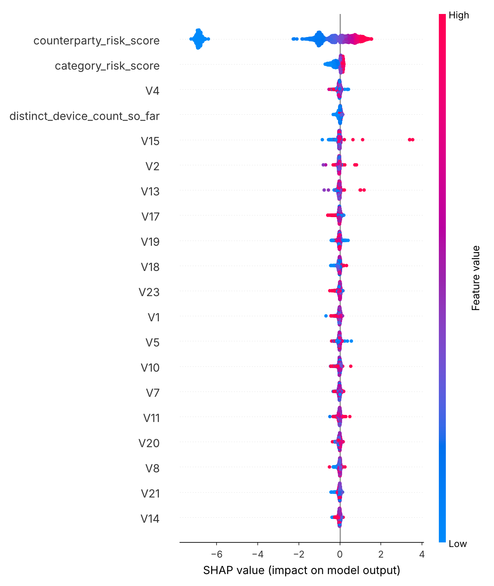
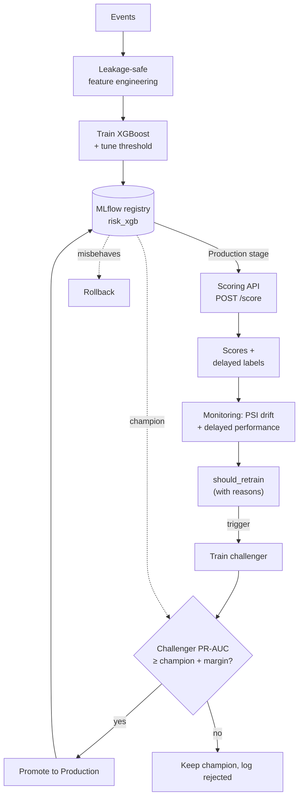

# RiskRelay

RiskRelay is a real-time risk-scoring pipeline for high-volume event streams.
An event is any action that needs a risk decision before it is accepted, such as
a payment, a login or an order. RiskRelay scores each event with XGBoost and
wraps the model in the parts that keep it trustworthy after deployment:
leakage-safe feature engineering, an online feature store with proven
train/serve parity, a versioned model registry, drift and decay monitoring, and
gated champion/challenger retraining.

The design target is a stream of 1M+ events/day with a positive rate around
0.1–0.3% and a scoring budget under 100 ms. Those three figures are the
constraints the design answers to; they are not measurements of this repo.
Everything under **Results** was measured here, on the synthetic dataset the repo
generates, whose realized positive rate is **2.35%** (see [Data](#data)).

[](https://github.com/Leah0705/RiskRelay/actions/workflows/tests.yml)


🎚️ **Interactive demo:** https://leah0705.github.io/RiskRelay/ lets you move the
decision threshold and watch the review queue go from 4,199 alerts a day to 83.
Every point is a real evaluation of the trained model on the held-out split.

## Results

> **Data note:** these numbers come from **synthetic** data and are a floor. Most
> of the positive labels in the generated set carry no PCA signal at all (see
> [Data](#data)), which caps every score below by construction. What this repo
> demonstrates is the **pipeline design**: leakage-safe splits, imbalance
> handling, validation-only threshold tuning, and a working lifecycle loop. Real
> event data with separating signal would score higher.

One chronological test split: 75,000 events over 4.55 days, 1,762 of them
high-risk (2.35%). From `reports/model_comparison.json`.

| Model | ROC-AUC | PR-AUC | Precision | Recall | F1 |
|---|---|---|---|---|---|
| Logistic Regression | 0.543 | 0.101 | 0.026 | 0.451 | 0.050 |
| Random Forest | **0.757** | **0.136** | 0.048 | 0.733 | 0.091 |
| XGBoost (tuned threshold, F1-optimal) | 0.724 | 0.112 | 0.068 | 0.255 | **0.107** |
| XGBoost (default 0.5 threshold) | 0.724 | 0.112 | 0.052 | 0.562 | 0.095 |



**Random Forest ranks best (PR-AUC 0.136 vs 0.112), and XGBoost serves because
it is far cheaper to run.** The serving path scores one event per request, so
the latency that matters is single-row inference at batch size 1
(`reports/model_latency.json`, 2-vCPU Linux cloud container):

| Model | p50 | p99 |
|---|---|---|
| Logistic Regression | 0.59 ms | 1.15 ms |
| **XGBoost** (serving, `n_jobs=1`) | **1.60 ms** | **3.56 ms** |
| XGBoost (as trained, `n_jobs=-1`) | 1.43 ms | 3.70 ms |
| Random Forest (as trained, `n_jobs=-1`) | 65.9–67.0 ms | 88–115 ms |
| Random Forest (`n_jobs=1`) | 14.4 ms | 22.5 ms |

Random Forest is quoted as a range because two runs gave different values; two
runs are not a distribution, so the range is stated as measured. On this shared
box the two XGBoost thread settings differ by less than the run-to-run noise.

Random Forest costs about **45× more per prediction** as trained, and about 9×
more with its own threads pinned. Measured end to end at concurrency 1, one
request takes about 5.5 ms at p50 on this box (171 RPS), and XGBoost inference
is about 1.5 ms of that. A 66 ms model would make inference the dominant cost
and push each request to about 70 ms. RiskRelay accepts a weaker ranker
that a single box can serve, and that is a trade with a real cost in ranking
quality.

Serving pins inference to one thread (`MODEL.serving_n_jobs`, applied in
`src/api.py`) while training uses every core. On this 2-vCPU box the two settings measure
about the same under load (171 vs 158 RPS at concurrency 1, 199 vs 204 RPS at
concurrency 8), so the case for pinning rests on the multi-worker deployment,
where each worker should own one core. See
[loadtest/results.md](loadtest/results.md).

The precision/recall spread tells the same story from the other side: Random
Forest catches 73% of positives at 19.7 false alarms per catch. Which point a
team can staff is a capacity question, and [Operating points](#operating-points)
answers it.

## Why this is non-trivial

1. **Extreme class imbalance.** High-risk events are rare, so accuracy is useless: always predicting "normal" scores 99.8% at a 0.2% positive rate. The generated dataset sits at 2.35%, a higher base rate that makes precision numerically easier, but most of its positives carry no PCA signal, which makes ranking harder. The scores are therefore not comparable to a production stream in either direction. RiskRelay reports precision, recall, F1 and PR-AUC, never accuracy.
2. **Temporal leakage.** A random split leaks the future through rolling features. Every split and feature here is **time-based and causal** (`src/data_loader.py::time_based_split`).
3. **Delayed ground truth.** Confirmed outcomes (manual review results, user reports, disputes) arrive days or weeks after the event. Data drift is visible immediately, while performance decay only shows once labels land, so the two are monitored as separate problems.
4. **Explainability for review and audit.** SHAP drives both global model validation and the per-event explanation a reviewer sees on an alert.

## Approach

Data → leakage-safe features → imbalance handling → model comparison →
validation-only threshold tuning → SHAP → registry → API serving → drift/decay
monitoring → gated retraining. Each trained model registers to a local MLflow
registry, and the API serves whichever version is in the `Production` stage. The
monitoring service watches drift and decay and can trigger a challenger, which
is promoted **only if it beats the champion on PR-AUC**.



The internals of the streaming feature store, the monitoring cadence, the
registry stages and the retraining gate are in
**[METHODOLOGY.md](METHODOLOGY.md)**.

## Data

Each row of `data/events.csv` is one event with `Time`, 28 anonymized PCA-style
features `V1`-`V28`, `Amount`, the label `Class` (1 = high-risk), and the identity
fields `account_id`, `counterparty_id`, `counterparty_category` (`cat_0` to
`cat_9`), `device_id` and a real `timestamp`. Velocity, counterparty-risk and
device-consistency features need those identity fields, which anonymized public
datasets usually drop.

**`--positive_rate` is a seed parameter, and the realized base rate is higher.**
The generator first plants `n_rows × positive_rate` positives that separate on 7
PCA components. It then flips additional normal rows to positive so that the
label correlates with counterparty category and device novelty; without that
step, `counterparty_risk_score` and `is_new_device` would be pure noise and the
engineered features would carry nothing. The documented command below
(`--positive_rate 0.0017`, seed 42) therefore produces:

| | count | share of positives |
|---|---:|---:|
| Planted, separate on PCA components | 850 | 7.2% |
| Flipped, correlate with counterparty/device only | 10,906 | 92.8% |
| **Total positives in 500,000 rows** | **11,756** | **2.35%** |

About 93% of the positives look like normal rows in PCA space. That explains
why PR-AUC lands near 0.11, why the mean shift on the 7 designated components
dilutes to about 0.2–0.3σ, and why SHAP ranks `counterparty_risk_score` first:
counterparty category is the strongest signal actually present, with positive
rates from 0.40% (`cat_6`) to 6.28% (`cat_4`). The pipeline is graded on a label
that is mostly noise, so the low absolute scores are a property of the data.
The generator is deterministic at seed 42 and the command reproduces the same
`data/events.csv` on every run.

**To use real data:** any file with the `Time`, `V1`-`V28`, `Amount`, `Class`
columns works, for example the public
[Kaggle credit-card dataset](https://www.kaggle.com/mlg-ulb/creditcardfraud).
Drop it at `data/events.csv` and run `train.py`. `src/data_loader.py` detects the
missing identity columns and synthesizes them on top of the real values, a
stand-in for a warehouse join, so the label signal stays genuine. The split is
always **time-based**.

## Model

Three models are trained and compared on the same chronologically last test
split (`reports/model_comparison.json`):

1. **Logistic Regression**: fast interpretable baseline and signal sanity check.
2. **Random Forest**: stronger nonlinear baseline and feature-importance cross-check.
3. **XGBoost**: the production model.

Random Forest is the better ranker here (PR-AUC 0.136 vs 0.112). XGBoost serves
because it is about 45× cheaper per prediction (1.4–1.6 ms vs about 66 ms,
`reports/model_latency.json`) on a workload where the model runs once per event
inside a 100 ms budget. Two other justifications would not have separated the
models, and they are listed here so nobody mistakes them for reasons:

- **Imbalance support.** XGBoost has `scale_pos_weight`; scikit-learn's Random
  Forest has `class_weight="balanced"`, and `src/models.py` already passes it.
  Both are reweighted the same way.
- **Exact SHAP.** `TreeExplainer` is exact for scikit-learn forests too. The
  XGBoost advantage is that attribution is *fast*.

The imbalance strategy is configurable (`--imbalance_strategy class_weight|smote|none`;
SMOTE is applied **after** the split). The decision threshold is tuned on the
**validation set only** (`src/imbalance.py::tune_threshold_for_f1`).

## Evaluation

PR-AUC and F1 are the headline metrics because accuracy rewards always
predicting "normal" under imbalance, while PR-AUC and F1 measure whether
high-risk events are actually caught. Tuning uses validation only, and the test
split is the chronologically last window, so nothing from the future leaks in.
The champion/challenger gate also compares on PR-AUC.

### Operating points

The scores rank events, and what reaches a human is whatever sits above the
cutoff. The cutoff therefore sets the daily workload. Below is the same XGBoost
at three thresholds, measured on the same test window
(`reports/operating_points.json`, regenerate with
`python scripts/operating_points.py`):

| Operating point | t | Precision | Recall | Alerts/day | False alarms per catch |
|---|---:|---:|---:|---:|---:|
| Random Forest, for reference | 0.50 | 0.048 | 0.733 | 5,874 | 19.7 |
| XGBoost, default | 0.50 | 0.052 | 0.562 | 4,199 | 18.3 |
| XGBoost, F1-optimal | 0.66 | 0.068 | 0.255 | 1,465 | 13.8 |
| XGBoost, precision-constrained | 0.81 | 0.289 | 0.066 | **88** | **2.5** |

The test window is 4.55 days at 16,477 events/day, so "alerts/day" is the queue
this model would generate at that traffic level.

Moving one number takes the queue from 4,199 alerts a day to 88 while the model
stays the same. On *this* data no point is comfortable: the precision-constrained
cutoff is the only staffable one, at 2.5 false alarms per catch, and it catches
7% of positives. On data with real separating signal the same curve sits
higher, and the mechanism for choosing a point on it is what this repo
implements.

## Reproduce it

Dependencies are in `requirements.txt`, and **seed = 42** throughout
(`DATA.random_state`). The shipped reports were produced with Python 3.13,
xgboost 3.4.1, scikit-learn 1.9.1, numpy 2.5.3, pandas 2.3.3 and mlflow 2.22.5;
other library versions give slightly different numbers.

```bash
pip install -r requirements.txt

# 1. Generate data (or drop a real events.csv in data/, see Data).
#    500,000 rows, 11,756 positives (2.35% realized, see Data on --positive_rate).
python data/generate_synthetic_data.py --n_rows 500000 --positive_rate 0.0017

# 2. Train, evaluate, SHAP, and register to the local MLflow registry.
#    The first model is auto-promoted to Production (the champion).
python train.py --imbalance_strategy class_weight   # regenerates the headline numbers

# 3. Serve the current Production model (resolved by stage, not a hardcoded path)
FEATURE_STORE_BACKEND=memory uvicorn src.api:app --host 0.0.0.0 --port 8000
#    ...or Redis-backed API + Redis together:  docker compose up --build

# 4. Tests (leakage sanity, streaming/batch parity, lifecycle).
#    23 tests. 22 run anywhere; the 23rd needs a reachable Redis and skips
#    without one (the same code path is covered in-process via fakeredis).
#    CI runs all 23 against a real Redis service container.
pytest tests/ -v

# 5. Watch the whole lifecycle fire on a simulated concept-drift event:
#    decay detected -> challenger trained -> gate accepts, then rejects -> rollback
python scripts/simulate_decay_demo.py

# 6. Review-queue volume at each operating point -> reports/operating_points.json
python scripts/operating_points.py

# 7. PR-AUC split by planted vs flipped positives -> reports/signal_decomposition.json
python scripts/signal_decomposition.py

# 8. Per-model single-row inference latency -> reports/model_latency.json
python loadtest/model_latency.py --hardware "your box here"

# 9. (optional) Browse the registry / runs:  mlflow ui --backend-store-uri ./mlruns
# 10. (optional) Load test /score:           python loadtest/loadtest.py --host http://localhost:8000
```

Steps 1, 2, 5, 6 and 7 are deterministic at seed 42 for a fixed set of library
versions. Steps 8 and 10 are timing measurements and will differ on your
hardware.

## Repo map

```
data/     synthetic event generator + inputs
src/      pipeline: features, imbalance, models, evaluate, explainability,
          online_features (streaming store), api, monitoring(+_service),
          registry, training_core, retraining
scripts/  simulated-decay lifecycle walkthrough; operating-point
          (review-queue volume) table; planted/flipped signal decomposition
tests/    leakage sanity, train/serve parity, lifecycle (gate/promote/rollback)
loadtest/ concurrency load test + measured RPS/p50/p95/p99; per-model
          single-row inference latency
reports/  generated metrics, SHAP plots, monitoring history (jsonl),
          operating points, model latency
docs/     interactive operating-point demo (GitHub Pages)
mlruns/   local MLflow tracking + registry file store (gitignored)
train.py  end-to-end training entry point
```

## Limitations & next steps

- The synthetic positive/normal separation is simplified; a real deployment validates against confirmed review outcomes in addition to held-out PR-AUC.
- There is no hyperparameter search yet (fixed XGBoost defaults); Optuna or Ray Tune should be wired in before treating the model as final.
- There is no formal model card or bias audit across account segments; both belong in place before regulated use.
- The champion/challenger gate scores both models on a common matrix encoded with the *challenger's* encoders. The comparison is fair between the two models (flagged in `src/retraining.py`); a fuller setup would re-featurize per model.
- Geo-mismatch and graph-based account-counterparty linkage features are not yet implemented.
- Model promotion is picked up on API **restart**; no hot-reload endpoint is wired in (noted in `src/api.py`).
- The demo's decay is a **deliberately injected, clearly labelled simulated** concept shift. It exercises the trigger/gate/rollback mechanics and makes no claim about real drift magnitudes.
- **The gate has never been exercised near its margin.** `promotion_min_pr_auc_gain` is 0.005, but the demo accepts at PR-AUC 0.981 vs 0.019 and rejects at 0.021 vs 0.988. Those gaps are about 190× the margin, so the demo proves that the decision *routes* correctly, and it says nothing about whether 0.005 is the right threshold. On the real leaderboard 0.005 is a 4.5% relative move on PR-AUC 0.112, and no run-to-run variance estimate exists to say whether that clears noise. Bootstrapping a confidence interval on PR-AUC and setting the margin above it is the missing piece.
- **The demo's "sustained" drift is synthesized.** `simulate_decay_demo.py` passes the same drift record twice to `summarize_drift` to satisfy `drift_sustained_cycles=2`, so the sustained-drift trigger is covered as logic and has not been validated across real consecutive monitoring cycles.
- **The serving output is an uncalibrated score.** Training with `scale_pos_weight` shifts predicted scores away from true posteriors, and the API field is still named `risk_probability`. Thresholding is unaffected because the tuned cutoff absorbs the shift, but any downstream expected-loss or cost calculation on that number would be wrong without a calibration step (e.g. a Platt or isotonic fit on validation).
- **Redis-backed serving is unmeasured under load.** The parity test proves the Redis store computes identical features, and CI runs it against a real server, but no throughput run exists for the Redis path. The horizontal-scaling story is designed and argued, and has not been benchmarked end to end.

## License

MIT, see [LICENSE](LICENSE).
